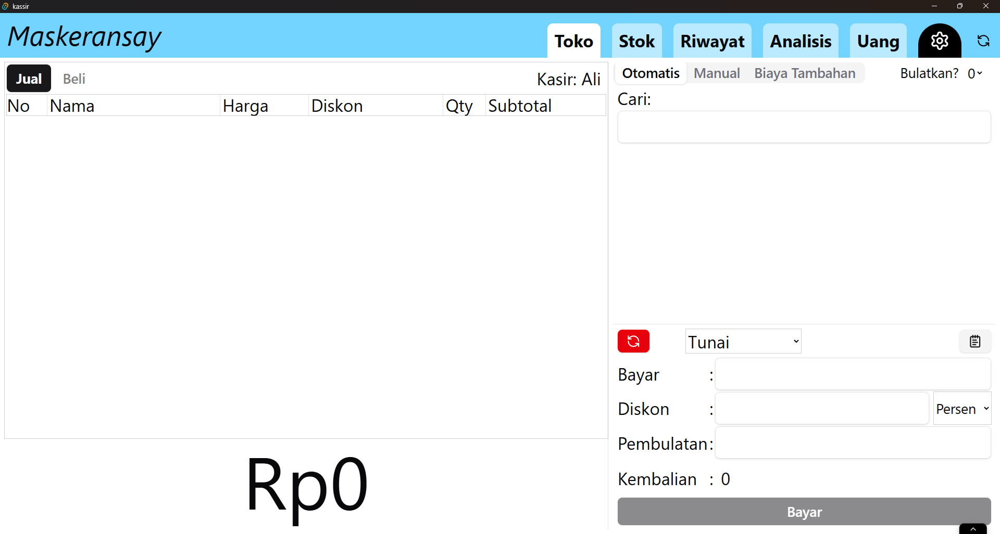

# Kassir

Aplikasi untuk kasir.



# TODO

- tambah extra baru harusnya revalidate cache

add indexing on product-events for performance

# Future plan

## Sync (deferred)

- No `sync` service yet — it is the orchestrator over the other services' `get.unsync` / `sync.upsert` / `syncAt` (see `src/services/PLAN.md`, catalogue #13 and Phase 5).
- `src/lib/sync/*` is stale: it imports the removed `~/store` and has to be rewritten on top of the services.
- `src/pages/Setting/Sync_PENDING/` is legacy (`~/store` + `Result`), is **not** registered in `src/pages/Setting/index.tsx`, and is deliberately left out of the settings nav (`src/pages/Setting/util-nav.ts`).
- Intended UI: a floating sync pill at the `AuthLayout` level, not a `/setting/sync` subpage.


# Windows installer

A `.msi` can only be produced on Windows. `tauri-bundler` gates the WiX-based MSI
packaging behind `#[cfg(target_os = "windows")]`, so on any other host it logs
`ignoring msi` and then fails with `No bundles were built`. A Linux machine can
build the NSIS installer instead (see below), never the MSI.

## From CI (recommended, and the only way to get an `.msi`)

`.github/workflows/windows-release.yml` runs on `windows-latest` and builds
`kassir_<version>_x64_en-US.msi` (see
[Windows installer docs](https://v2.tauri.app/distribute/windows-installer/)):

- **Automatically** on a push to `master` — attaches the installer to a **draft**
  release tagged `v<version from package.json>`. Pushes that only touch
  `.github/**` or markdown files are ignored, so tweaking CI does not try to
  rebuild an already-released version.
- **On demand** — *Actions → Publish Windows App → Run workflow*. The **ref
  dropdown picks the branch to build**, which is the normal way to get an
  installer for a branch that is not `master`:

```sh
gh workflow run windows-release.yml --ref prod                    # draft, tag v6.2.0
gh workflow run windows-release.yml --ref prod -f draft=false     # publish right away
gh workflow run windows-release.yml --ref prod -f tag=v6.2.0-test  # custom tag
```

The manual trigger has to live on the default branch for GitHub to show it,
which is why this file is on `master`; other branches are built by selecting them
as the ref. Keep `draft` on unless you mean to publish: `tauri-action` updates an
existing release with the same tag, so dispatching a version whose tag already
exists touches that release's assets unless you pass a custom `tag`.

## From this Linux machine (NSIS only)

Two things are needed first:

1. **Case-correct import paths.** Imports reference page folders in the wrong
   case (`./pages/shop` vs `Shop`, `~/pages/shop/store/product`,
   `./product/Detail`, `./pages/login`, …) and there is a case-duplicate
   `src/pages/record/index.tsx`. Windows resolves all of these because NTFS is
   case-insensitive; on Linux the build aborts with
   `Could not resolve "./pages/login" from "src/route.tsx"`. `dev` fixed this in
   `33264a2`; it is **not** applied to `prod`/`master`.
2. **A cross toolchain**: `clang`/`llvm` (for `clang-cl`, `llvm-rc`), `lld` (for
   `lld-link`), `nsis` (for `makensis`), plus
   `rustup target add x86_64-pc-windows-msvc` and
   `cargo install --locked cargo-xwin`.

Then:

```sh
sudo apt install clang llvm lld nsis

bunx tauri build --runner cargo-xwin --target x86_64-pc-windows-msvc \
  --config '{"bundle":{"targets":["nsis"]}}'
```

Both flags matter: without a Windows `--target` the configured bundle targets are
filtered against the host OS, and `--bundles nsis` is rejected outright on Linux
(`possible values: deb, rpm, appimage`), so the target list has to come from
`--config`. `createUpdaterArtifacts: true` additionally requires
`TAURI_SIGNING_PRIVATE_KEY` (and `..._PASSWORD`); without it the build stops at
"A public key has been found, but no private key".

Output: `src-tauri/target/x86_64-pc-windows-msvc/release/bundle/nsis/*-setup.exe`.

References: [Windows installer / cross-compilation](https://v2.tauri.app/distribute/windows-installer/),
[updater signing](https://v2.tauri.app/plugins/updater/),
[cargo-xwin](https://github.com/rust-cross/cargo-xwin).
