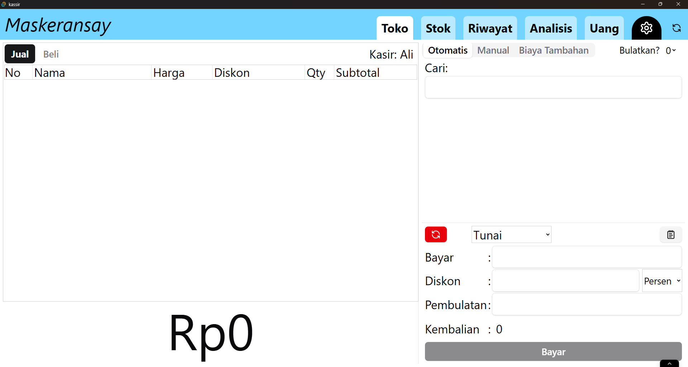

# Kassir

Aplikasi untuk kasir.

# TODO

- tambah extra baru harusnya revalidate cache
- add indexing on product-events for performance

# Sinkronisasi

**Sync v2, all eight groups.** Contract: `SYNC-V2.md`. The desktop mirrors `money`
(pockets + ledger), `customer`, `supplier`, `method`, `social`, `extra`, `product`
(catalog + stock journal) and `record` (the sale aggregate). It is **started
manually**: the operator presses a button; there is no timer and no sync-on-launch.
The run itself is a background task: it belongs to the sync service, not to the
screen, so leaving Pengaturan → Sinkronisasi keeps it going, a small status pill in
the bottom-left corner follows it on every screen, and only an explicit cancel stops
it.

A product detail page also has a scoped **one-product sync** (Sinkronkan produk,
admin only): push that product's dirty rows, then pull the server's snapshot of the
same product, then move that product's image bytes. It never moves the product
group's bookmark and never touches another group. Contract:
`docs/SYNC-V2-ONE-PRODUCT.md`; implementation: `src/services/sync/one-product.ts`.

The transport lives in Rust, not the webview: the window CSP is
`connect-src 'self' ipc:`, so a `fetch` to the sync host is blocked before it leaves,
and the WebView cannot read a streamed NDJSON body under `ipc:`.
`src-tauri/src/sync.rs` owns the socket and pushes NDJSON lines to JS one per Tauri
`Channel` message; `src/services/sync/stream.ts` turns that back into the reader the
rest of the code is written against.

## The two endpoints

| Direction | Call | What comes back |
|---|---|---|
| pull | `GET /v2/<group>/pull/:seq?limit=<default>` | `meta` → `row`/`ag`/`del` … → `done` |
| push | `POST /v2/<group>/push` (NDJSON body) | `ack` per frame → `done` |

There is **no session, no upload id, no byte offset and no hash chain** in v2. Each
request stands alone, every frame — in both directions — is idempotent, and the only
client state is one integer per group plus the parked money rows.

The record group is the one aggregate: a pull line is `ag` and carries the 20-column
header plus all five child arrays (`record_listings`, `record_methods`,
`record_extras`, `record_images`, `discounts`); a push frame carries the same under
`ch`. A record is never split across frames, and its children are never synced on
their own.

## Groups, and one progress bar each

The protocol is grouped by tables, and each group is an **independent stream**: its own
endpoint pair, its own column dictionaries, its own bookmark. The screen renders one
progress bar per group (`GroupState` per group in `SYNC_GROUPS` order), so a group
that is finished keeps saying so while the next one runs. Groups are visited serially;
a trigger that arrives mid-run asks for one more pass instead of starting a second
cycle over the same bookmark (§9.11).

| group | entities | pull | push |
|---|---|---|---|
| `money` | `pocket`, `money` | 5000 / 20000 | 1000 frames / 1 MB |
| `customer` | `customer` | 5000 / 20000 | 1000 / 1 MB |
| `supplier` | `supplier` | 5000 / 20000 | 1000 / 1 MB |
| `method` | `method` | 5000 / 20000 | 1000 / 1 MB |
| `social` | `social` | 5000 / 20000 | 1000 / 1 MB |
| `extra` | `extra` | 5000 / 20000 | 1000 / 1 MB |
| `product` | `product`, `product_name`, `property`, `listing`, `image`, `product_event` | 5000 / 20000 | 1000 / 1 MB |
| `record` | the record aggregate | 1000 / 5000 (+8 MB page budget) | 1000 / 8 MB |

A group's bar spans its **whole cycle**, not one phase: `pull`, `merge`, `push` and
the closing pull are weighted into a single fraction and clamped upward, so it fills
once instead of emptying at every phase boundary. The pull's fraction is real, not a
spinner — `done.s` against the first `meta.snapshot`.

## One run, four stages (per group)

1. **Unduh (pull)** — one page per request. Lines are decoded as they arrive and held
   for the merge of *that page* only. A transport/5xx failure is retried with
   exponential backoff (§4.11); a `400`/`410` re-seeds the group (§9.8).
2. **Simpan (merge)** — the page, its parked money rows and its bookmark are applied as
   **one transaction** through the `sync_merge` command. `tauri-plugin-sql` has no
   transaction handle (its `execute` runs a multi-statement string in autocommit), so
   that command borrows the plugin's own pool — it publishes `DbInstances` and
   `DbPool::Sqlite` — and runs `BEGIN … COMMIT` on one connection. The bookmark is
   written **inside** that transaction, so a crash re-fetches a page rather than
   skipping one (§9.4.1).
3. **Unggah (push)** — the rows/records whose `*_sync_at IS NULL`, in the group's order
   (pockets before money; product before children and before the journal), within the
   frame and byte bounds. One ack per frame: `applied`/`noop` set `*_sync_at = seq`;
   `stale` carries the server's winning row/aggregate, which is merged immediately
   unless the row changed since it was sent (§4.12).
4. **Unduh lagi** — picks up whatever another till wrote while this one was pushing.
   Usually one empty page.

## The merge rules

One rule per merge kind, applied in three places (client pull, server apply, client
`stale` ack), so both sides always agree:

- **plain LWW** — `pocket`, `customer`, `supplier`, `method`, `social`, `extra` and the
  seven catalog entities (`product`, `category`, `product_category`, `product_name`,
  `property`, `listing`, `image`): newer `*_updated_at` wins; a tie keeps the stored copy.
- **`money`** — insert, note edit and soft delete only. `timestamp`, `money_value` and
  `pocket_id` are **immutable**: an amount that has been recorded is a fact, so a later
  push can never rewrite the ledger. A copy that disagrees on any of the three loses
  and is repaired from the server's row.
- **`product_event`** — append-only: a new id is inserted, an existing id is a `noop`
  whatever its payload. A correction is a new event.
- **`record`** — full LWW on the whole aggregate: header + five child sets replaced
  wholesale. Child array order is not semantic.

Deletes are `*_deleted_at` tombstones and travel as ordinary rows; the clock that
accompanies one is `max(now, stored + 1)` (§5.1.1), so an edit never ties with the
value it replaces. A money row whose pocket is not on this device yet is **parked**
(never dropped, never allowed to abort the page) and retried against every later page.
A live child under a soft-deleted parent is an **orphan**: kept, hidden and counted,
never auto-deleted (§6.6).

## What syncs

Everything listed in the group table above. `cashiers`, `cashier_roles`, `stocks`
(derived from the event journal), the `tx_*` cart tables, enum/vocabulary tables and
image **bytes** are local-only. A record's five child tables travel inside the record
aggregate, never as separate frames.

## Cursors

In SQLite (written with the page they describe):

- `sync_bookmark(group_name, seq)` — one integer per group: the highest `seq` durably
  stored.
- `sync_parked_money(money_id, seq, row_json)` — money rows waiting for their pocket.

In `store.json`: `sync.token`, `sync.base_url`, `sync.device_id`. The pre-table keys
`sync.<group>.bookmark` and `sync.money.parked` are read once and migrated into the
tables.

`Sinkronisasi Ulang` sets every bookmark to `0` and marks **every** synced row
unsynced, keeping content and clocks — the seeding procedure (§13.4), and the remedy
when the device and the server disagree. A pull `400` does the same automatically; a
`410` re-seeds from the server's `floor` instead of `0` (§9.8). Nothing is deleted on
either path.

## Where it lives

| Path | Role |
|---|---|
| `src-tauri/src/sync.rs` | HTTP + NDJSON stream transport (per group), cancellation, the `floor` on a `410` |
| `src-tauri/src/sync_merge.rs` | the merge as one real SQLite transaction |
| `src/services/sync/schema.ts` | every group's column dictionaries and limits (the wire contract) |
| `src/services/sync/frames.ts` | NDJSON frame encode/decode (rows and the record aggregate) |
| `src/services/sync/sql.ts` | guarded upserts, markers, aggregate replacement, the unsync reads, bookmark/park writes |
| `src/services/sync/merge.ts` | the four merge kinds, the page apply, the park |
| `src/services/sync/pull.ts`, `push.ts`, `retry.ts` | the two loops and the shared backoff policy |
| `src/services/sync/stream.ts`, `transport.ts` | the Channel→stream polyfill, and the Rust commands as a service |
| `src/services/sync/live.ts` | the service: per-group cycle, bookmarks, park, progress, re-seed, service refresh |
| `src/services/sync/one-product.ts` | the scoped one-product cycle: push → snapshot pull → scoped image bytes (`SYNC-V2-ONE-PRODUCT.md`) |
| `src/pages/Setting/Sync/` | Sinkronisasi (admin-only): server address + token with a health check, then run |

Tests: `src/services/sync/sync.test.ts` — the four merge rules, plus whole cycles
against a real SQLite and a protocol-faithful fake server (every group, the record
aggregate, second device, ack compare-and-set, parked money, refused bookmark, `410`
floor).

## Turning it on

Pengaturan → **Sinkronisasi** (admin only). The server address is a setting, seeded with
`SYNC_DEFAULT_BASE_URL` (`https://api.kassir.store/api`) — change it for a self-hosted or
staging backend; fill in the sync token, press **Cek** to ping that address's
`/v2/health` and see the answer inline, then save and press **Sinkronisasi** — the
buttons stay disabled until both fields are stored. A plain-`http` address is refused
unless it names the local machine, because the token is a full read/write credential.

For a local server, the address depends on how it runs: the full Docker/dev stack
exposes the API under `/api`, so use `http://localhost:8787/api`; a bare backend
(`cd kassir-server/backend && bun run dev`) serves the routes directly, so use
`http://127.0.0.1:8788` with no `/api`.

Rows written before v2 existed have no server-side counterpart, so the first run after
this upgrade will not upload them by itself: press **Sinkronisasi Ulang** once, which
queues every synced row.
